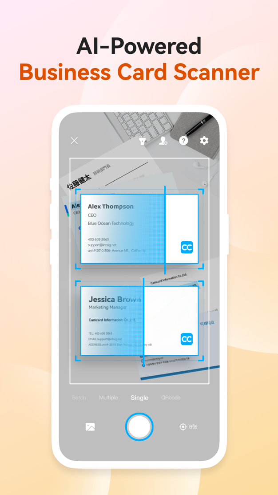
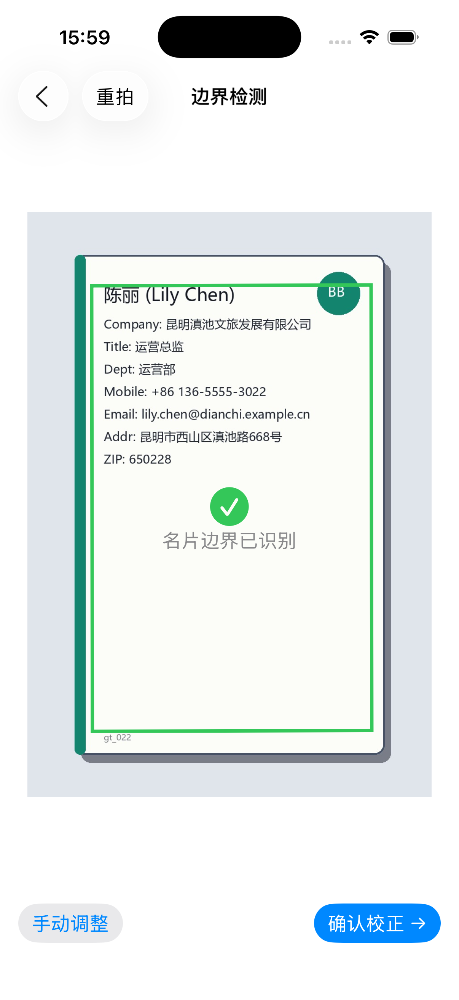
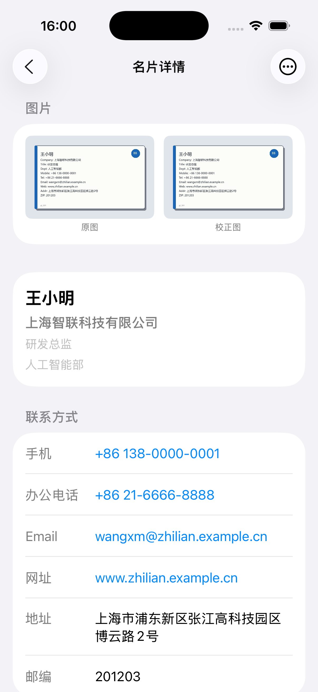
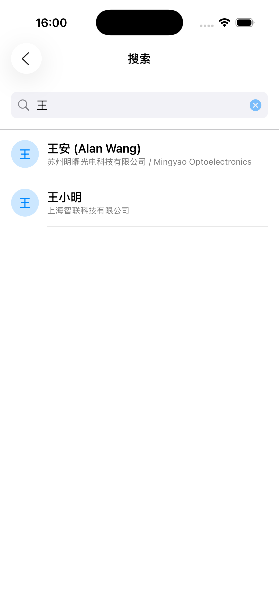
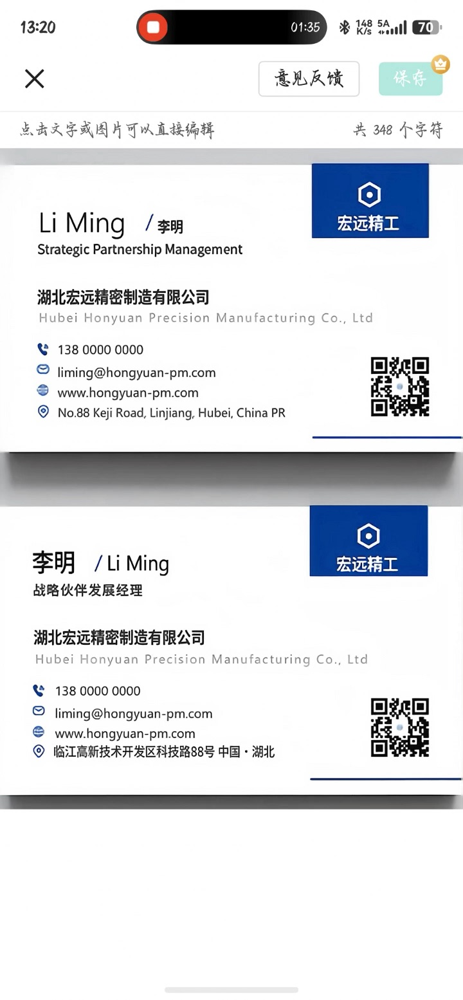
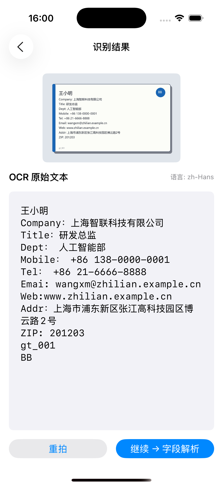
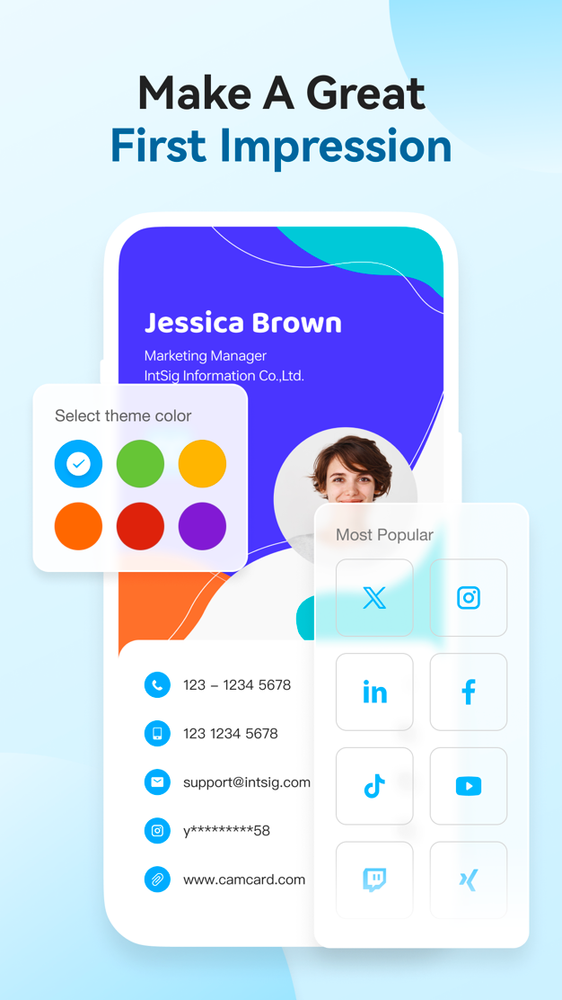
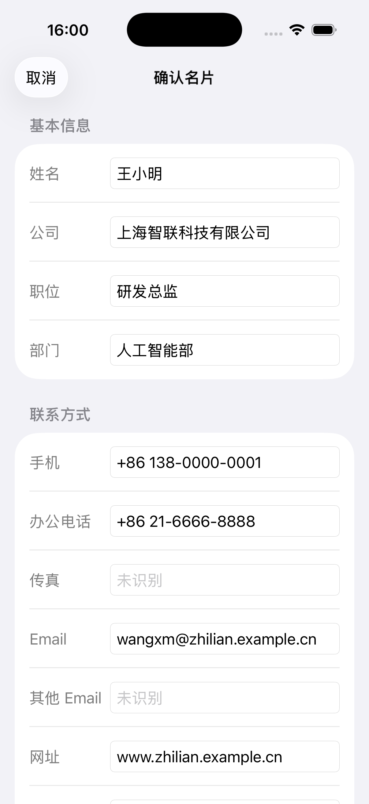

# UI 截图对比（CamCard 参考版 vs BlackBox）

> 对应作业 Week 5「UI Golden Test」与 Week 6「UI 截图对比」。
> 完整带图版本见仓库根目录 `UI截图对比报告.docx`。

## 1. 参考素材

| 项目 | 内容 |
|------|------|
| App | 名片全能王（CamCard），开发者 INTSIG（上海合合信息） |
| 版本 | 8.65.0（App Store 当前在线版，2026-10-19 发布） |
| 来源 | Apple App Store 官方商店页公开截图，共 7 张 |
| 素材位置 | `Tests/ReferenceScreenshots/camcard_01.jpg` ~ `camcard_07.jpg` |

### 局限（必须说明）

1. 商店截图是带设备外框与营销文案的**宣传图**，不是 App 内原始截屏。
2. 版本为商店当前在线版，**不是教师锁定的参考版本**，仍需教师确认。
3. iOS 应用无法通过命令行下载安装（模拟器无 App Store，IPA 受 Apple ID / DRM 限制），该 App 也无 macOS 版，因此未取得实机原始截图。
4. 本对比定位为「基于公开素材的初步对照」，不能完全替代锁定版本下的实机截图对比。

## 2. 对比维度

按作业定义：UI 一致性、交互一致性、状态一致性、数据一致性、异常一致性、流程一致性。

## 3. 对比一：名片扫描 / 识别

| 维度 | 参考版 8.65.0 | 本项目 | 判定 |
|------|---------------|--------|------|
| UI 一致性 | 顶部：关闭/闪光灯/切换/设置；底部：相册缩略图/快门/计时；右侧三个悬浮动作 | 顶部：取消/闪光灯；底部：相册/快门/重拍 | 核心控件齐全，布局不同 |
| 交互一致性 | 取景时实时框选，支持连拍/多张拍 | 拍摄后进入边界检测页，自动框选 + 手动四点调整 | 路径不同，任务可达 |
| 状态一致性 | 权限拒绝引导、重拍、取消 | 同左（含「去设置」） | 一致 |
| 异常一致性 | 拍摄失败可返回 | 可返回并重试，不崩溃 | 一致 |
| 流程一致性 | 拍摄 → 识别 → 保存 | 拍摄 → 边界检测 → OCR → 校正 → 保存 | 多了人工确认环节 |

## 4. 对比二：名片夹 / 名片管理

| 维度 | 参考版 8.65.0 | 本项目 | 判定 |
|------|---------------|--------|------|
| UI 一致性 | 常驻搜索框 + 消息 + 添加；四个功能入口；「我的名片」+ 管理面板 | 标题栏 + 搜索/标签/扫描入口；列表显示姓名/公司/职位/缩略图 | 范围内入口齐全 |
| 交互一致性 | 搜索常驻；管理面板含导出、保存到通讯录、分组、去重、回收站、同步 | 独立搜索页 + 标签筛选；详情页导出系统通讯录 / VCF | 范围内一致 |
| 状态一致性 | 空状态、列表、批量管理 | 空状态、列表、标签计数、删除确认 | 一致 |
| 数据一致性 | 列表/详情/统计同步 | 列表↔详情↔编辑↔搜索↔标签同步（T14/T18） | 一致 |
| 异常一致性 | 未登录/网络异常提示 | 本地应用无网络依赖；异常路径见 T20 | 范围内一致 |
| 流程一致性 | 扫描 → 名片夹 → 详情 → 分享/导出 | 扫描 → 保存 → 名片夹 → 详情 → 搜索/标签/导出 | 闭环一致 |

说明：参考版「分组管理」对应本项目标签体系；人脉地图、人脉分析、名片去重、100% 识别、回收站、一键同步属作业第十五节排除项。

## 5. 范围外页面

| 参考截图 | 页面 | 作业处理 |
|----------|------|----------|
| camcard_01 | 人脉搜索 | 不要求复刻 |
| camcard_04 | 名片更新 / 数据统计 | 不要求复刻（CRM） |
| camcard_05 | 名片访客 | 不要求复刻（CRM） |
| camcard_06 | 数字名片 | 不要求复刻（云名片） |
| camcard_07 | 企业查询 | 不要求复刻（企业查询） |

## 6. 结论

- 在作业要求的 10 项范围内，参考版可见的关键 UI 结构与交互路径，本项目均有对应实现，未发现范围内缺失的必要入口。
- 差异集中在布局组织与拍摄链路，不改变任务可达性与数据结果。
- **已补充（2026-10-28）**：详情页、搜索页、边界检测/校正页、编辑页已找到可对比的官方公开图，见第 8 节。OCR 识别结果页 CamCard 无公开界面图，改用教师批准的 CamScanner 一手录屏帧对照。
- **仍缺**：锁定版本的**应用内原始截图**（现有素材均为营销图或录屏帧），以及教师对版本号的确认。

## 7. 补充对照：详情页 / 识别结果 / 搜索（依据官方手册，无截图）

> App Store 截图未展示这些页面。以下依据 INTSIG 官方公开手册（CamCard Android 5.1 / Web v1.0）的文字描述补充，
> **属于二手资料，手册版本较旧且无界面截图，不能作为像素级对比证据**。

| 页面 | 参考版官方手册描述 | 本项目 | 判定 |
|------|--------------------|--------|------|
| 名片详情 | 名片图 + 联系信息；工具条「删除 / 导出 / 编辑」；导出为 vCard；快捷菜单支持拨号 / 邮件 / 短信；备注支持文字、图片、提醒 | 详情页含名片图 + 全部字段；电话 / 邮箱 / 网址 / 地图跳转；编辑 / 删除 / 导出（vCard + 系统通讯录） | 范围内一致；短信与备注提醒未实现 |
| 识别结果编辑 | 字段级「识别结果编辑区」；**选中某项时上方名片图高亮其位置**；姓名不可删；可添加其他项目；可加名片背面图；可云识别 | 字段校正页支持 8 字段全部可改、多电话分流、多 Email、人工修正标记 | 方向一致；**未实现「选中字段 → 原图高亮」** |
| 保存 | 可选分组、保存到通讯录、删除名片、右上角保存 | 保存到本地名片夹 + 标签；详情页另行导出通讯录 / vCard | 能力对等，入口位置不同 |
| 搜索 | 分组内按数字 / 拼音 / 公司名搜索，命中**蓝色高亮** | 独立搜索页，覆盖姓名 / 公司 / 职位 / 电话 / Email，支持标签筛选 | 范围更宽；**未实现关键词高亮** |
| 标签 / 分组 | 分组管理：新增、改名、删除；名片可归组 | 标签管理：新增 / 删除 / 按标签筛选 | 能力对等，模型不同（扁平标签 vs 分组） |

**可信度边界**：手册为 Android 5.1 / Web 1.0 版本，早于商店当前 8.65.0；手册内的界面图未入库，故本节只能证明「行为有无」，不能用于 UI 布局对比。

## 8. 补充对照：校正 / 详情 / 搜索 / OCR / 编辑（有参考截图）

> 2026-10-28 新增。参考图来自 CamCard 官网产品页（`camcard.com/zh-cn`）与 App Store 中国区/美区公开截图，
> 本项目图为 `Tests/AcceptanceEvidence/` 的验收截图；素材清单见 `Tests/ReferenceScreenshots/README.md`。
> 参考图仍是**营销宣传图**、且**不是教师锁定版本**，因此本节只做「同页面、关键控件与路径」级别的对照。

### 8.1 边界检测与校正

参考：`Tests/ReferenceScreenshots/camcard_store_boundary.png`（拍摄页，两张名片同时框选）
本项目：`Tests/AcceptanceEvidence/03_T06_boundary.png`

| 维度 | 参考版 | 本项目 | 判定 |
|------|--------|--------|------|
| UI 一致性 | 取景画面叠加青色矩形框，逐张卡片框选；底部拍摄模式与快门 | 全屏原图 + 绿色检测多边形（手动调整时变橙色，四角白色圆点）+ 底部「重拍 / 确认校正 →」 | 都是「彩色框 + 可拖角点」，但承载页面不同（拍摄中 vs 拍摄后） |
| 交互一致性 | 实时框选，可同时框多张 | 拍摄后自动检测；点「手动调整」后拖四角 | 路径不同，任务可达 |
| 状态一致性 | 实时框选 / 已锁定 | 检测中 / 已识别 / 未检测到（手调兜底）/ 检测失败（重试） | 本项目状态更细，多一层兜底 |
| 数据一致性 | 框选结果进入识别 | 四点坐标驱动透视校正 | 一致（都决定后续裁剪区域） |
| 异常一致性 | 未对准时可重拍 | 未检测到提示 + 手动调整 + 重拍 | 本项目更明确 |
| 流程一致性 | 拍摄 → 框选 → 识别 | 拍摄 → 检测 → 校正 → OCR | 多一步人工确认 |

### 8.2 名片详情

参考：`Tests/ReferenceScreenshots/camcard_site_detail.png`（官网产品页：名片详情 + 编辑名片 / 更换样式）
本项目：`Tests/AcceptanceEvidence/09_T13_detail.png`

| 维度 | 参考版 | 本项目 | 判定 |
|------|--------|--------|------|
| UI 一致性 | 顶部姓名 + 职位 + 公司，中部电话/邮箱/地址，底部「编辑名片 / 更换样式 / 分享」 | 顶部姓名 + 公司 + 职位 + 部门，分组列出联系方式 / 标签 / 图片 / 备注，导航栏「编辑 / 导出 / 删除」 | 信息层级相近；参考版强调品牌样式，本项目按字段分组 |
| 交互一致性 | 电话/邮箱可点；编辑、分享入口 | 手机/办公电话/传真可拨号、Email 可发信、网址可打开；编辑 / 导出 / 删除 | 范围内一致；分享、换样式不在作业范围 |
| 状态一致性 | 未登录/网络状态影响同步 | 纯本地，无网络态；操作失败弹提示 | 合规裁剪 |
| 数据一致性 | 详情与名片夹、通讯录同步 | 详情 ↔ 编辑 ↔ 搜索 ↔ 标签同步（T13/T14/T18） | 一致 |
| 异常一致性 | 缺失字段不展示 | 缺失字段不渲染该行，数据层保持 nil（T09） | 本项目不臆造，更严格 |
| 流程一致性 | 名片夹 → 详情 → 拨号/邮件/编辑 | 名片夹 → 详情 → 拨号/发信/导出/编辑 | 闭环一致 |

说明：参考图是 CamCard 的**数字名片/我的名片**详情（官网产品页），与本项目「扫描后保存的名片详情」同域但不完全同款；扫描名片详情页无公开截图。

### 8.3 搜索

参考：`Tests/ReferenceScreenshots/camcard_store_search.png`（人脉搜索：搜索结果列表）
本项目：`Tests/AcceptanceEvidence/11_T15_search.png`

| 维度 | 参考版 | 本项目 | 判定 |
|------|--------|--------|------|
| UI 一致性 | 顶部搜索框 + 结果卡片列表（头像、姓名、职位、公司） | 顶部搜索框 + 名片行（首字圆形头像、姓名、公司） | 搜索框 + 结果列表结构一致 |
| 交互一致性 | 输入即搜；结果可进入详情 | 输入即搜（200ms 防抖）；结果可进入详情 | 一致 |
| 状态一致性 | 空查询 / 无结果 / 有结果 | 「开始输入以搜索」/「未找到匹配的名片」/ 结果列表 | 三态齐全，一致 |
| 数据一致性 | 搜姓名/公司/职位 | 搜姓名/公司/职位/手机/Email | 本项目覆盖更宽 |
| 异常一致性 | 无网络时提示 | 本地数据；搜索异常弹提示 | 合规裁剪 |
| 流程一致性 | 名片夹 → 搜索 → 详情 | 名片夹 → 搜索 → 详情 | 一致 |

说明：参考版截图为「人脉搜索」（企业/公开名片），与作业要求的「本地名片搜索」不完全同域；命中关键字蓝色高亮见第 7 节手册描述，**本项目未实现关键词高亮**。标签筛选在首页完成，不在搜索页。

### 8.4 识别结果（OCR）

参考：`Tests/ObservationEvidence/10_OCR文本可编辑_01m35s.jpg`（CamScanner 一手录屏帧；CamCard 无公开的识别结果页界面图）
本项目：`Tests/AcceptanceEvidence/04_T07_ocr.png`

| 维度 | 参考版（CamScanner） | 本项目 | 判定 |
|------|----------------------|--------|------|
| UI 一致性 | 原图 + 文本层叠加，顶部「共 N 个字符」+ 保存 | 独立「OCR 原始文本」页：语言标签 + 原文列表 + 重拍 / 继续 | 呈现方式不同（点选编辑 vs 独立页） |
| 交互一致性 | 点文字即改 | 原文只读，点「继续 → 字段解析」进入校正页 | 本项目保留可信原文，符合规格 |
| 状态一致性 | 处理中 / 识别完成 | 识别中 / 成功 / 失败（重试） | 一致 |
| 数据一致性 | 文本层与导出内容一致 | Raw Text 落盘并随名片保存 | 一致 |
| 异常一致性 | 识别失败提示重试 | 「识别失败」+ 重试 / 重拍 | 一致 |
| 流程一致性 | 拍摄 → 文本层 → 保存 | 拍摄 → 校正 → OCR → 原文 → 字段 → 保存 | 本项目链路更长但可解释 |

### 8.5 编辑

参考：`Tests/ReferenceScreenshots/camcard_store_edit.png`（名片样式编辑：配色 + 社交链接）
本项目：`Tests/AcceptanceEvidence/10_T14_edit.png`

| 维度 | 参考版 | 本项目 | 判定 |
|------|--------|--------|------|
| UI 一致性 | 样式编辑面板：主题配色 + 社交链接（公开图只覆盖「更换样式」） | 「编辑名片」= 字段校正页复用：基本信息 / 联系方式 / 备注三段 +「保存名片」 | 参考图未覆盖字段表单，字段级编辑只能按第 7 节手册文字对照 |
| 交互一致性 | 选色/勾选后即时预览 | 逐字段编辑，保存后回详情 | 都能就地修改，入口不同 |
| 状态一致性 | 编辑中 / 已保存 | 编辑中 / 已保存 / 保存失败（弹窗） | 一致 |
| 数据一致性 | 详情、名片夹同步 | 详情、列表、搜索、导出同步（T14） | 一致 |
| 异常一致性 | 未登录时限制部分样式 | 保存失败提示错误，不丢失编辑内容 | 范围不同，均不崩溃 |
| 流程一致性 | 详情 → 更换样式 → 返回 | 详情 → 编辑 → 保存 → 返回 | 一致 |

说明：`camcard_store_edit.png` 是 CamCard 的**外观编辑**（配色/社交链接），并非字段编辑表单；字段编辑页的形态依据第 7 节官方手册（选中某项时名片图高亮对应位置），**无公开截图**，本节不宣称已做像素级对比。

**素材局限（必须保留）**：8.1–8.5 的参考图均为官网营销图或商店宣传图，含设备外框与文案排版，尺寸/状态栏与本项目截图不同，**不能做像素级 diff**；CamCard 识别结果页没有公开界面图，8.4 用 CamScanner 录屏帧替代，已在前文标注。

---

*2026-10-28 · 初步版本*
